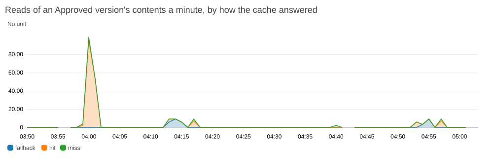

# What the cache gains

How long reads of Approved versions take with the cache and without it, and what PostgreSQL is sent for them. [The cache keeps the contents of Approved versions](adr/0016-the-contents-of-approved-versions-are-read-from-a-cache-that-is-never-needed.md): everything else a read answers with is read from PostgreSQL every time. These are measurements under a made-up load, on one machine and on generated data. They say what the cache saves in the app as it is built, and nothing certain about the deployed one: of the deployed host there are the times of [half a minute of reads](#on-the-deployed-host) and of a handful of requests, and no more. The handful is from the look at what the deployed app does when its cache is stopped, which is [at the end](#the-cache-stopped-on-the-host).

Four things limit what they say:

- **Everything ran on one machine.** The program that sent the requests, the web server, the API, PostgreSQL, and Redis shared a processor with twelve cores and had no network between them. The host has two processors, which it may use in full only for a while, and runs the worker and an agent beside them.
- **One person read, and nobody wrote.** Every request was the same person's, and nothing else used the app. The API had answered the same requests before any was timed.
- **The data is generated or seeded.** The largest catalog there can be is made by the app for measuring, and the demo has no catalog near its size. The seeded catalog measured has 151 feature rows and 7 offerings.
- **They are two runs.** The tables are of the second, and the medians of both are below them. Both are of the code as it is.

## Results

Times are in milliseconds, from sending a request until its whole answer had arrived.

The four columns are the app without an address for the cache; with the cache, when it held nothing of what the request reads; with the cache holding it; and with the cache stopped while the requests were sent.

### One after another, 30 requests

| | Cache off | On and empty | On and holding it | Cache stopped |
|---|---|---|---|---|
| Opening the largest Approved version | median 558, 95th percentile 601, longest 627 | median 566, 95th percentile 594, longest 599 | median 68, 95th percentile 82, longest 92 | median 616, 95th percentile 1315, longest 1388 |
| Opening a seeded Approved version | median 34, 95th percentile 84, longest 87 | median 34, 95th percentile 52, longest 73 | median 6.8, 95th percentile 8.3, longest 8.4 | median 30, 95th percentile 107, longest 111 |
| Comparing two versions of one lineage | median 46, 95th percentile 52, longest 55 | median 54, 95th percentile 145, longest 159 | median 8.4, 95th percentile 9.7, longest 9.8 | median 50, 95th percentile 65, longest 81 |

### 8 at once, 3 times

| | Cache off | On and empty | On and holding it | Cache stopped |
|---|---|---|---|---|
| Opening the largest Approved version | median 706, 95th percentile 802, longest 812 | median 694, 95th percentile 789, longest 797 | median 133, 95th percentile 178, longest 189 | median 704, 95th percentile 747, longest 760 |
| Opening a seeded Approved version | median 55, 95th percentile 83, longest 85 | median 42, 95th percentile 56, longest 56 | median 13, 95th percentile 18, longest 19 | median 65, 95th percentile 126, longest 128 |
| Comparing two versions of one lineage | median 57, 95th percentile 66, longest 67 | median 66, 95th percentile 75, longest 77 | median 15, 95th percentile 20, longest 21 | median 55, 95th percentile 92, longest 94 |

### Statements PostgreSQL was sent for one request

| | Cache off | On and empty | On and holding it | Cache stopped |
|---|---|---|---|---|
| Opening the largest Approved version | 14 | 14 | 8 | 14 |
| Opening a seeded Approved version | 14 | 14 | 8 | 14 |
| Comparing two versions of one lineage | 20 | 20 | 8 | 20 |

### The medians of both runs

The first run's median, then the second's.

| | Cache off | On and empty | On and holding it | Cache stopped |
|---|---|---|---|---|
| The largest version, one after another | 553, 558 | 555, 566 | 70, 68 | 602, 616 |
| A seeded version, one after another | 30, 34 | 34, 34 | 7.9, 6.8 | 28, 30 |
| A comparison, one after another | 45, 46 | 52, 54 | 8.7, 8.4 | 44, 50 |
| The largest version, 8 at once | 723, 706 | 634, 694 | 127, 133 | 687, 704 |
| A seeded version, 8 at once | 35, 55 | 41, 42 | 13, 13 | 80, 65 |
| A comparison, 8 at once | 55, 57 | 58, 66 | 17, 15 | 99, 55 |

One after another, the medians of the two runs are close: none differs by more than 6 ms, but for the largest version, where none differs by more than 14. Eight at once they are further apart: a seeded version without a cache took 35 in one run and 55 in the other. So what eight at once say is how the columns stand to each other, and not the figures. The statements were the same in both runs.

## What they say

**The cache saves the reading of the contents, which is most of a read.** With the cache holding it, the largest version opens in about an eighth of the time, 68 ms against 558, a seeded one in about a fifth, and a comparison in under a fifth. PostgreSQL is sent 8 statements where it was sent 14: the six that read the contents are not sent. A comparison reads two versions, and is sent 8 where it was sent 20.

**What is left is not the cache's to save.** The 68 ms that remain for the largest version go to finding the session and the person, to what describes the catalog, to validating it against the library of today, and to writing 1.8 million characters of JSON. They were not taken apart.

**A read that finds the cache empty costs a little more than one without a cache.** It reads PostgreSQL as before and then gives the cache what it read, which for the largest version is 2 MB: a median of 566 against 558. The job that follows an approval gives the cache a new version before anyone opens it, so the reads that pay this are the first of a version after a day in which no one opened it, and the first after the demo reset.

**With the cache stopped, a read takes about what it takes without one.** The first read after the stop waits for the cache, for 250 ms at the most. From then on no read asks it, and the app asks by itself every ten seconds whether it is back. One after another, the medians of the last column are within 6 ms of the first's for the seeded version and the comparison, and 58 ms above it for the largest version, which is a tenth. No request of either run failed.

**Some reads take much longer than the median, and what they wait for is the disk of the machine they were measured on.** Without a cache, one read in twenty of a seeded version took over 80 ms where the median is 34. Sent one after another for half a minute, nearly a fifth of the reads took over twice the median, and the long ones grew from one to the next until they started low again. Every request writes when its session was last used, and PostgreSQL does not say that it is written before the disk has it. On this machine the disk takes 5 ms for that at the median and over 50 ms in stretches. The cache has no part in it, and the deployed host does not show it: [what was measured](#the-long-reads) is below. Two reads of the largest version took 1.3 s with the cache stopped, in one run. Those two were not seen again, and whether they waited for the disk too is not known.

**For the catalogs the demo has, the cache gains nothing that matters.** A seeded version opens in 34 ms without the cache and in 7 with it, and no one notices the 27 between them. What the cache is worth shows at sizes the demo does not have: at the largest size, nearly half a second for each opening.

**It does nothing for editing.** A working copy is never in the cache. Saving a cell of the largest catalog answers with its issues after about half a second, [as measured before](largest-catalog-measurements.md), and does so still.

## Reads of one version that arrive together

Twenty reads of the largest version were sent at once, with the cache holding nothing of it, and the statements that read its cells were counted.

| | Times PostgreSQL was asked for the cells |
|---|---|
| As first built | 10 |
| With the loads of one version made one at a time | 1 |

The API has ten connections to PostgreSQL, so ten of the twenty read at a time. As first built, each of the ten found the cache empty and read the contents, and the ten after them found them in the cache. Now the reads of one version that the cache does not hold take turns inside one process: the first reads PostgreSQL and gives the cache the contents, and the others wait and then find them there. The API and the worker are two processes, and each takes its own turns.

## The long reads

Reads of the seeded Compact SUV 2026 v2 were sent one after another for 30 seconds, without a cache, on 2026-10-11. One command, run in `e2e/`, starts the stack, sends them, and says how even their times were:

```sh
npm run reads:even
```

```
796 reads of a seeded Approved version in 30 seconds, one after another, without a cache: median 27 ms, 144 over twice the median, and at the most 3 of those one after another.
```

The long reads do not follow one another. One or two short ones come between them, and it is the long ones that grow and then start low again. In the first run below, the long reads of one stretch took 58, 63, 65, 69, 75, 77, 83, and 88 ms, in about a second.

### What they wait for

The reads were sent again with PostgreSQL logging every statement with its time, the API logging every request with its own, and Java logging its garbage collections. That is the first row. For the second, PostgreSQL was also told not to wait for the disk when a transaction ends, with `synchronous_commit = off`, and nothing else was changed.

| | Reads | Median | Over twice the median | Longest |
|---|---|---|---|---|
| PostgreSQL waits for the disk, as it does unless told otherwise | 694 | 27.5 ms | 151 | 193 ms |
| It does not wait | 1,338 | 22.2 ms | 0 | 31 ms |

In the first row, the time is in one place: the `COMMIT` that ends the writing of the session's last use.

| | Reads | The read | The API's own time | That `COMMIT` |
|---|---|---|---|---|
| Reads over twice the median | 151 | 91 ms | 90 ms | 68 ms, and never under 30 |
| The others | 543 | 30 ms | 28 ms | 6.9 ms, with a median of 4.4 |

They are averages. A read without that `COMMIT` took 23 ms at the median and 33 at the most, so no read was long for another reason. Of the 694 commits, 257 took over 10 ms and 100 over 50.

The disk does the same with no app and no PostgreSQL. A script wrote 8 kB to a file of 16 MB in a Docker volume and had it flushed with `fdatasync`, as PostgreSQL does at a commit, then waited 24 ms and did so again, for 30 seconds. Of 598 flushes the median took 9.3 ms and 293 over 10 ms, and they grew as the commits do: 53, 66, 87, 91, 97, 104 ms one after another, and low again a second later. Docker keeps its volumes on btrfs here, with compression, on a disk the rest of the machine uses. On the machine's other disk, which has ext4, the same script's 1,227 flushes took 0.2 ms at the median and 4 ms at the most. Why the first of the two flushes so was not looked into: it is the file system's or the disk's, and not the app's.

### What it is not

- **The cache.** The app had no address for one.
- **Garbage collection.** Java collected 76 times in the 30 seconds, for 3.1 ms at the most and 92 ms in all, where a long read takes 30 ms more than a short one at the least.
- **The API's threads and its connections to PostgreSQL.** The reads were spread evenly over ten threads, and every thread had its share of the long ones, between 12 and 19 of about 70. Two connections carried the statements of all the reads, and both had long commits, of 170 and 130 ms at the most.
- **The session's row.** Every request writes it anew, so old copies of it pile up: 201 were left at the end, and PostgreSQL had cleared them away once. Reading the session took 0.02 ms and writing it 0.04 ms, in long reads and in short ones.
- **Any other statement.** Each of the others took the same in long reads as in short ones, to within 0.05 ms. Reading the cells took 0.21 ms in both. PostgreSQL logged no checkpoint in the 30 seconds.
- **The web server and the client that sent the reads.** A read took 1.6 ms longer than the API's own time for it at the median, and 2.9 ms at the most.
- **The tracing of every request.** It ran in both rows of the first table, and the second has no long read.

### What it costs

On a machine whose disk flushes like this one, about one request in five takes 30 to 170 ms longer than the others. That is true of every request and not only of reads, since each writes its session. One such wait is below what a person notices. The 95th percentiles and the longest times of the tables above were measured on the same disk, so they say more of it than of the app. The medians hold: at the median the commit takes 5 ms.

The app is left as it is. The stretches are this machine's, and the app does not choose the disk it is measured on. That PostgreSQL waits for the disk is what keeps a saved edit when the machine fails, so it is not turned off for the measuring either: the host waits too, and the times here should be of the app as it runs there. The table above says what the waiting costs here: the median is 22 ms without it and 27.5 with it.

### On the deployed host

On 2026-10-11, from 10:26:58 UTC, the demo author's reads of Compact SUV 2026 v2 were sent to the deployed app one after another for 30 seconds, from the machine of the measurements above, and nothing else was sent. The cache held the version throughout.

| | Reads | Median | Over twice the median | Longest |
|---|---|---|---|---|
| As timed where they were sent from, with the way there and back | 391 | 70 ms | 3, never two together | 156 ms |
| The API's own times, from its log | 396 | 16 ms | 22, at the most 3 together | 95 ms |

The API's log has the five reads that were sent first and not timed as well. Of its 22 over twice the median, 8 are among the first 20 reads, which took longer than the rest as a whole and less from one to the next: 47, 31, 53, 30, 32, 35, 25, 38 ms at the start, where three reads in four of the half minute took between 12 and 19 ms. Why the first took longer was not looked at. The other 14 are spread over the half minute, one to three at a time, between 34 and 60 ms but for one of 95, and do not grow from one to the next. So the host does not show the stretches. Its Docker volumes are on xfs. With the cache holding the version a read there still writes its session and waits for the disk, as every request does.

## How they were measured

One command, run in `e2e/`, with nothing else on the stack's ports:

```sh
npm run cache:measure
```

It runs `e2e/cache-workload.mjs`, which does all of this and prints the three tables and the count of the twenty:

1. It starts the browser tests' stack with the largest catalog and without an address for the cache, as `CACHE_HOST= LARGEST_CATALOG=true npm run stack:up` does. The stack serves the production build of the frontend behind the web server, with the API, the worker, PostgreSQL, and Redis each in a container.
2. It signs in as the demo author in a browser, and from then on sends every request with Node's own HTTP client and the session's cookie, to the web server's address.
3. For each of the three kinds of request it sends 5 that are not timed, then 30 one after another, then 8 at once three times. Each is timed from sending until the whole answer has been read. That is the first column.
4. It starts the API and the worker again with the cache's address, signs in again, and does the same twice. The first time it deletes the entries of the versions a request reads before every request, and before every 8 at once, so that each finds the cache empty. The second time it deletes nothing.
5. It deletes the largest version's entry, sends 20 reads of that version at once, and counts the statements that read its cells.
6. It stops the cache with `docker compose stop` and does step 3 once more, which is the last column. A request that is not answered with success stops the script.
7. It removes the stack and its data.

The statements are counted apart from the times, for one more request of each kind in each column. PostgreSQL is told to log every statement, the request is sent, and the log since then is read. Statements that start or end a transaction are left out, and so are those of the two things the API does by the clock: looking for the messages of new jobs, and ending sessions that have run out. With `STATEMENTS=1` the script prints the ones it counts.

The count of ten is from an earlier run, made before the loads of one version took turns. The count of one is from both runs here.

The half minute of reads is apart from the two runs, and is [above](#the-long-reads) with its command. The script that logged every statement and the one that flushed a file were not kept.

## The cache stopped on the host

On 2026-10-11 the cache was stopped on the host on purpose, for two minutes, with `docker compose stop cache`, and started again. Meanwhile the demo author opened Compact SUV 2026 v2 on the deployed app and compared it with v1, four times over. Times are in UTC.

| | |
|---|---|
| 04:53:28 | The cache is stopped. |
| 04:53:35 | The first read after it waits for the cache and is answered from PostgreSQL. The API's log says that the cache stopped answering. |
| 04:53:35 to 04:54:56 | Four openings and four comparisons, each answered 200 and each the same as before the stop: the same contents, the same issues, the same differences. The API is ready each time it is asked. |
| 04:55:37 | The cache is started again. |
| 04:55:45 | The API's log says that the cache answers. Nobody asked for the app's health: the app found the cache by itself, 8 seconds after it was back. |
| 04:56:40 | The first opening after that finds the cache empty and fills it, and the ones after it are answered from the cache. |

The API's log has those two lines about the cache and no other. The alarm on the backend's health stayed as it was, and did not change all that night.

The API's own times for these requests, in milliseconds:

| | Opening the version | Comparing the two |
|---|---|---|
| Before the stop, the cache holding both | 43 | 59 |
| The first after the stop, which waited for the cache | 384 | 165 |
| The other three while it was stopped | 110, 107, 69 | 131, 110, 115 |
| After its return, the cache holding both | 37, 25 | 78, 34 |

They are one person's requests, a handful of each, on the seeded catalogs: enough to say that the app answers as before with the cache stopped, and too few to say what the cache gains there.

The dashboard's chart of the reads, by how the cache answered them:



The reads at 04:00 are the ones sent to [measure the host's memory](host-memory-measurements.md). The fallbacks at 04:54 and 04:55 are this stop, and the hits and the misses at 04:57 the reads after it. A count is sent once a minute, so it shows in the minute after its reads.

The fallbacks from 04:13 to 04:15 are an earlier stop, from 04:12:20 to 04:14:30, on the app as it was built two releases before. Readers saw the same then: every opening and comparison answered 200, the same as before. But the app went on reading from PostgreSQL for half a minute after the cache was back, until its health was asked for. The client had come to wait half a minute between its tries to reach a cache that was gone. It now tries every two seconds, which is what the 8 seconds above show.

## Environment

- Measured on 2026-10-10, with the application as the repository built it that day.
- AMD Ryzen 9 5900X, 32 GB of memory, Linux 7.2. Docker 29.9.0 with Compose 5.6.0 keeps its volumes on btrfs.
- Node 24.21.0 sent the requests. Chromium, driven by Playwright 1.63, signed in.
- Spring Boot 4.1.1 on Java 25, PostgreSQL 18.6, Redis 8.10.2, and Caddy 2.11.6, each in a container on the same machine.
