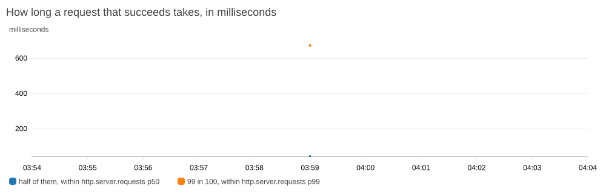

# How long a person's list of working copies takes

How long the API takes to answer a person's list of twenty working copies, `GET /api/catalogs?scope=mine`, which the dashboard asks for each time it is opened and after a working copy is deleted or withdrawn, and where that time goes. These are the figures before any change: one run on the deployed app and one on one machine, each of twenty working copies of the demo's largest catalog, asked for by one person. The figures after a change go beside them when there is one. [The decision](adr/0022-a-working-copys-counts-of-errors-and-warnings-are-kept-with-the-revisions-they-were-worked-out-against.md) that rests on them is to keep each working copy's counts of Errors and Warnings with the revisions they were worked out against, and it waits for the maintainer.

Where the time goes was known before any trace was read. The code marks the place as a shortcut taken on purpose, in `CatalogController.java`: "each working copy is read whole and validated, ten queries apiece for the 20 an owner can have at most. Keep the counts with the catalog if this list gets slow". The trace of the run's median ask confirmed it and measured it: 388 of the request's 417.6 ms go with the twenty reads, as [the trace](#the-trace-of-the-median-ask) below has it.

Five things limit what the figures say:

- **The catalogs are the demo's.** Every working copy is a copy of Sedan 2027 v1, the largest catalog the demo starts with: 172 feature rows by 10 offerings, with 1,070 stored cells and 6 rules. Twenty of the largest catalog there can be, 500 feature rows by 96 offerings, were not listed.
- **One person asked, one after another, and nobody else was made to.** The deployed app is open to anyone, and nothing kept others away during the run. The API's log for the run's minute holds no list but the run's and the command's own, so nobody else asked for a list then, and whether anyone asked for anything else was not looked at.
- **The API had just started.** The run began 1 minute 55 seconds after the API's start that the release before it caused, so the first asks were among the first requests the API answered. The API's own times for the thirty drift down through the run, from about 450 ms to about 380, so a warmer API may answer somewhat faster than the median says, and still well over the bar.
- **The bar is held on asks that follow five others.** The first ask after the copies were made is written down by itself, and four more are not timed, before the thirty that are.
- **It is one run on the host and one on one machine.** The machine's run is of the command before a change to how it deletes, and a run after the change gave the same median.

## Results

Times are in milliseconds. "As sent" is from sending the request until its whole answer had arrived, where it was sent from. "The API's own" is what the API's log says the request took, from the line `GET /api/catalogs 200 in … ms`. The two differ by what lies between, which on the host is the way to the site and back and the web server, and on the machine the web server alone.

### The times

| | The host, as sent | The host, the API's own | One machine, as sent |
|---|---|---|---|
| The first ask after the copies were made | 857 | 804 | 221 |
| Thirty one after another, median | 478 | 416 | 96 |
| Thirty one after another, 95th percentile | 572 | 458 | 125 |
| Thirty one after another, longest | 627 | 507 | 162 |

The host's columns are of 2026-10-14, from 03:58:54 UTC, and the machine's of the same day from 03:52:26 UTC, both before any change. The columns after a change, if one is made, go beside them.

The thirty on the host, in order, as sent: 493, 513, 487, 504, 508, 543, 505, 504, 572, 462, 477, 470, 497, 494, 627, 438, 438, 439, 478, 443, 447, 456, 488, 439, 428, 503, 465, 431, 493, 439. As the API's log has them: 440, 458, 432, 452, 454, 425, 452, 449, 456, 409, 426, 416, 432, 443, 507, 387, 389, 388, 428, 392, 396, 403, 435, 388, 378, 382, 408, 381, 377, 388. The four asks between the first and the thirty took the API 604, 526, 479, and 516. The median as the API's log has it is the 15th of the thirty sorted, 416, as the command counts; the 16th is 425. Sending adds about 60 ms to each: 478 against 416 at the median.

The thirty on the machine, as sent: 109, 106, 116, 125, 95, 107, 100, 96, 95, 112, 94, 98, 162, 99, 98, 95, 84, 109, 99, 95, 95, 91, 94, 95, 104, 89, 88, 91, 85, 100. An earlier run on the same machine, of the command before its deleting was changed, had the first ask at 214 and the thirty at a median of 96, a 95th percentile of 116, and a longest of 138.

### Statements PostgreSQL is sent for a list of twenty

| | Before |
|---|---|
| Statements for one list of twenty, counted from the code | 202 |

One looks the caller up, one is the list itself, and ten are sent for each working copy: one for the catalog's own row, six for its contents, and three for the library as it is today, which the test of reading one catalog holds at ten. Beginning and ending each of the twenty transactions, and the request's own session, are not among them. Nothing has counted the 202 as they are sent: a test that does comes with a change, and its count goes here beside this one.

### The trace of the median ask

The median ask is the one the API's log timed at 416 ms, at 03:59:09.818 UTC. Its trace holds 61 spans: the request's, `/api`, of 417.6 ms, and sixty steps, all directly under it, three for each of the twenty working copies. No other span: a working copy is not read from the cache. Of a span's record this gives the name, the parent's name, the start, the length, and the catalog's id, and nothing else.

| Step | How many | Together, ms | Each, ms |
|---|---|---|---|
| `catalog.read`, the catalog's own row and its contents | 20 | 196.6 | 9.0 to 16.0 |
| `catalog.library`, what validation needs of the library | 20 | 152.7 | 7.1 to 7.6, and the first 15.2 |
| `catalog.issues`, working out the issues | 20 | 15.8 | 0.76 to 0.88 |
| All steps | 60 | 365.2 | |
| The request | | 417.6 | |
| What the steps leave over | | 52.5 | |

The 52.5 ms the steps leave over, split by the steps' starts and lengths:

| | ms |
|---|---|
| Between one working copy's steps and the next's, where one transaction ends and the next begins: 19 gaps | 23.2, of 1.1 to 1.6 each |
| Within one working copy's three steps: 40 gaps | 2.3, of 0.05 to 0.1 each |
| Before the first step, which the request does once | 21.8 |
| After the last step, which the request does once | 5.1 |

So 388 ms of the 417.6 go with the twenty reads, which are the three steps and the gaps between copies, and about 27 ms is what the request does once: finding the session, looking the caller up, the list's own statement, and writing the answer out, none of which a step covers. The copies are listed newest first, and the trace reads them in that order. Each copy, with its steps' first start and last end counted from the request's start, and what each step took:

| Working copy | From | Until | `catalog.read` | `catalog.library` | `catalog.issues` |
|---|---|---|---|---|---|
| 1st | 21.8 | 48.0 | 10.0 | 15.2 | 0.9 |
| 2nd | 49.3 | 73.5 | 16.0 | 7.2 | 0.8 |
| 3rd | 74.7 | 93.2 | 10.2 | 7.4 | 0.8 |
| 4th | 94.3 | 112.2 | 9.8 | 7.2 | 0.8 |
| 5th | 113.3 | 131.5 | 9.8 | 7.4 | 0.8 |
| 6th | 132.6 | 150.2 | 9.3 | 7.3 | 0.9 |
| 7th | 151.5 | 169.5 | 9.9 | 7.3 | 0.8 |
| 8th | 171.1 | 188.5 | 9.2 | 7.2 | 0.8 |
| 9th | 189.7 | 207.2 | 9.4 | 7.3 | 0.8 |
| 10th | 208.5 | 225.8 | 9.3 | 7.1 | 0.8 |
| 11th | 227.0 | 244.3 | 9.2 | 7.3 | 0.8 |
| 12th | 245.5 | 263.8 | 9.7 | 7.6 | 0.8 |
| 13th | 265.1 | 282.4 | 9.3 | 7.2 | 0.8 |
| 14th | 283.6 | 301.0 | 9.3 | 7.2 | 0.8 |
| 15th | 302.2 | 320.0 | 9.8 | 7.1 | 0.8 |
| 16th | 321.0 | 338.3 | 9.2 | 7.2 | 0.8 |
| 17th | 339.5 | 357.1 | 9.5 | 7.2 | 0.8 |
| 18th | 358.3 | 375.4 | 9.1 | 7.1 | 0.8 |
| 19th | 376.5 | 393.5 | 9.0 | 7.1 | 0.8 |
| 20th | 394.7 | 412.5 | 9.7 | 7.2 | 0.8 |

The trace after a change, if one is made, goes here as a second table, with the steps that are gone or that took less named.

### The dashboard's chart

The chart "How long a request that succeeds takes", drawn by command from the dashboard's own definition of it for the ten minutes around the run, so it has no console around it:



It shows that something was slow at 03:59 and not what: the chart merges every route, since the API tells its requests apart by their outcome alone, and that minute holds the run's twenty creations and twenty deletions beside its thirty-five asks. The nine other minutes drew nothing, the release at 03:57 among them. What its "half of them" point stands at was not read from the metric.

### The maintainer's screenshot

The trace of the median ask as the CloudWatch console draws it is the maintainer's to take, from Application Signals, Transaction Search, by the trace's id, which the ticket's comment gives him. It goes here, beside the chart, cropped to the trace's spans with nothing of the console's frame, and looked at first for everything [the dashboard's record](dashboard-and-alarms.md#how-a-picture-is-made-safe-to-publish) lists. It has not been taken yet, and the table above stands on its own meanwhile.

## What they say

**The list of twenty is over the bar, and the place is the one the code names.** The API answers it in a median of 416 ms on the host, where a quarter of a second was asked for, and 388 of the median ask's 417.6 ms are the twenty reads with the transactions between them. What the request does once is about 27 ms.

**Reading the library costs nearly as much as reading the catalog, and validation almost nothing.** For each working copy the three statements that read what validation needs of the library take 7.1 to 7.6 ms, against 9 to 16 for the catalog's own row and its six tables of contents, and 0.8 for working out the issues. The library's three statements bring back a handful of rows, so their time is the round trips to the database, and not the rows. Reading the global rules once for the whole list would spare two of those three statements for each copy and no more: the request's time less all twenty readings of the library is 264.9 ms, over the bar before anything is spared. That is why the decision keeps the counts instead.

**The first ask after the copies were made took about twice the median,** 804 ms against 416, and the four untimed asks after it 604, 526, 479, and 516. The copies had just been written, and the API had answered few requests since its start.

**Sending adds about 60 ms on the host,** by the median as sent against the API's own, 478 against 416. The machine's API's own times were not read, so what sending adds there is not known.

**On one machine the same list takes 96 ms.** The machine has twelve cores and no network between the browser tests' stack's containers, where the host has two of another kind and a database in a container beside the API.

## How it was measured

One command, run in `e2e/`, with the site, the account, and the password given from outside, and the local stack when it is given no site:

```sh
npm run list:measure                                       # the browser tests' stack, as visitor
SITE=https://<the site> ACCOUNT=visitor PASSWORD=… npm run list:measure
npm run list:measure -- look                               # the role and the count, nothing made
npm run list:measure -- delete <stamp>                     # the twenty of one run, by their names
```

It runs `e2e/working-copy-list.mjs`, which does all of this and prints the figures of the host's and the machine's "as sent" columns:

1. It signs in once in a browser, headless, as the account, and from then on sends every request with the session's cookies. On the deployed app it got through the sign-in page Amazon Cognito draws in about three seconds, with the same fields as the local login server's. If the page cannot be driven, it opens a browser window for a person to sign in and goes on with that session. It prints no cookie, token, or password.
2. It prints the account's role and how many working copies its list holds. If the list holds any, it makes nothing and stops: the twenty of a run are all its own.
3. It makes twenty working copies, each from the current Approved of Sedan 2027, named `List of twenty <stamp> 01` to `20` with the time to the second, and keeps the ids the API answers with. It prints the version they were made from.
4. It asks for the list once and prints that time by itself, asks four times more untimed, and then thirty times one after another, each timed from sending until the whole answer had arrived. Every answer is checked to hold the twenty it made and no other; one that does not stops the run.
5. It prints from when until when the list was full, in UTC, and the median, 95th percentile, and longest of the thirty.
6. It deletes the twenty it made, by their ids, also when it stopped early, withdrawing one that someone submitted meanwhile, and signs out.

Before the run on the deployed app, `aws sts get-caller-identity` answered; `gh run list --branch main` showed no release under way, and `gh pr list` which pull requests were open; the command was run in `look` mode; and these were written down:

- The commit released: `gh run list --workflow Deploy --branch main --limit 1 --json headSha,conclusion,updatedAt`.
- The API's start time: the newest line `Started VehicleCatalogApplication in … seconds` of the stream `backend` in `/vehicle-catalog/backend`, with `aws logs filter-log-events --log-stream-names backend --filter-pattern '"Started VehicleCatalogApplication in"'` over the last three hours.
- The host's processor credits: `aws cloudwatch get-metric-statistics --namespace AWS/EC2 --metric-name CPUCreditBalance --period 300 --statistics Average` over the last half hour, the newest value taken, for the host found by its tag as `infra/README.md` finds it, with the id read into a variable and printed nowhere.

After it:

- The API's own times: `aws logs filter-log-events --log-group-name /vehicle-catalog/backend --log-stream-names backend --filter-pattern '{ $.message = "GET /api/catalogs *" }'` over the run's minute, every line's time and message kept, and the run's thirty-five told from others by lying between the times the command printed. The minute, 03:59, held 36 such lines: the run's thirty-five and the command's own read before it deleted, at 03:59:18.717, and nobody else's. The thirty timed are the 6th to the 35th.
- The trace: the median line's `traceId`, and the command `infra/README.md` gives for a trace, with a start time ten minutes before the run, listing each span's name, parent, start, length, and `catalog.id`, and nothing else of its record.
- The chart: the widget's definition from `aws cloudwatch get-dashboard`, given a start, an end, a width of 1000, and a height of 320, drawn with `aws cloudwatch get-metric-widget-image --output-format png` and looked at before it was kept. The dashboard's body stays outside the repository.
- The spans the run added, counted by one Logs Insights query over `aws/spans` for 03:58 to 04:01 UTC, by span name, with the group's stored size read first.

The machine's column is of the browser tests' stack, started with `npm run stack:up` and removed with `npm run stack:down` afterwards, with the command given no site: Caddy, the API, PostgreSQL, and the Redis cache in containers, without the largest catalog, as `visitor`, whose list is empty there after a start.

## What it does not show

- **A fault nobody knew of.** The trace has the three steps of each read and the request's span, and all of the time but about 27 ms lies in them or between them.
- **The statements inside a read.** No step times a single statement, so which of the seven statements of `catalog.read` takes its 9 to 16 ms, or how the three of `catalog.library` share their 7, is not known.
- **What lies before the first step,** 21.8 ms, and in each gap between two copies, 1.1 to 1.6 ms. No step covers the session's reading, the caller's lookup, the list's own statement, or a transaction's beginning and end.
- **Many people at once,** and what the list does to other requests while it holds a thread and a connection for half a second.
- **A list of twenty of the largest catalog there can be.**
- **A warm API.** The one measured had started 1 minute 55 seconds before.
- **The machine's API's own times.** Its log was not read; its column is as sent alone.

## When, and on what

- **The host:** 2026-10-14, the run from 03:58:54.457 to 03:59:20.897 UTC, with `visitor`'s list full from 03:59:00.564 until 03:59:18.269, which is 17.7 seconds, and empty before and afterwards, with the role author. The commit released was `4b57a6c`, whose Deploy ended at 03:57:47; the API had logged `Started VehicleCatalogApplication in 19.499 seconds` at 03:57:03.668; the host's `CPUCreditBalance` was 576.0, the newest five-minute average before the run, at 03:53. The copies were made from Sedan 2027 v1 and deleted by the run, twenty of twenty. No release ran during it, and the run was made once.
- **The machine:** 2026-10-14, from 03:52:26 UTC, with the list full from 03:52:27.186 until 03:52:30.909. AMD Ryzen 9 5900X, 32 GB of memory, Linux 7.2, Docker keeping its volumes on btrfs, with containers of other projects running beside the stack. Node 24.21.0 sent the requests, and Chromium, driven by Playwright 1.63, signed in. The earlier run on the same machine was from 01:50:16 UTC.
